# 🎬 Awesome 3D Computer Vision & Motion Capture 🕺

  

    
    
    
    
    
    
  

  

    
  

  

    <strong>🌟 A Curated Index of SaaS Platforms &amp; Open-Source Projects for 3D Computer Vision, Markerless Motion Capture (MoCap), Human Mesh Recovery (HMR), Multi-View Kinematics &amp; AI Character Replacement 🚀</strong>
  

---

## 📌 Overview & SEO Highlights

Welcome to the definitive hub for **3D Computer Vision**, **Markerless AI Motion Capture (MoCap)**, and **3D Human Pose Estimation (HPE)**! 🎯

This repository indexes state-of-the-art tools and cutting-edge research algorithms that translate monocular or multi-camera RGB video, optical infrared arrays, and inertial sensors into 3D skeletal data (`.bvh`, `.fbx`), parametric human body meshes (**SMPL**, **SMPL-X**, **MANO**), OpenSim biomechanical dynamics (`.trc`, `.mot`), and seamless VFX video character replacement.

Whether you are a **computer vision researcher**, **biomechanist**, **game animator (Blender, Unreal Engine, Unity)**, or **VFX artist**, this catalog provides production-ready SaaS platforms alongside top open-source repositories to accelerate your spatial computing and animation pipelines. 💡

---

## 📑 Table of Contents

- [📈 Sector Overview & Market Dynamics](#-sector-overview--market-dynamics)
- [☁️ SaaS & Hosted Platforms](#️-saas--hosted-platforms)
- [💻 Open-Source GitHub Projects](#-open-source-github-projects)
  - [⭐ Top Repositories (Ranked by Stars)](#-top-repositories-ranked-by-stars)
  - [🛠️ Additional Libraries & Frameworks](#️-additional-libraries--frameworks)
- [🤝 How to Contribute](#-how-to-contribute)
- [💖 Support](#-support)
- [📊 Star History](#-star-history)
- [⚠️ Disclaimer](#️-disclaimer)

---

## 📈 Sector Overview & Market Dynamics

The global 3D motion capture and computer vision kinematics market is estimated at approximately **$318M to $486M in 2025–2026**, projected to approach nearly **$1B by 2030** at a compound annual growth rate (CAGR) of **~12.5%–13.6%**. 

The sector exhibits **moderate-to-high fragmentation**:
- **Legacy Optical Giants**: Enterprise hardware leaders such as Vicon (Oxford Metrics) and Qualisys dominate sub-millimeter clinical biomechanics, medical gait labs, and AAA game/VFX virtual production stages.
- **Democratized AI Markerless SaaS & Web3/Gaming**: High-velocity entrants like Move.ai, Plask, DeepMotion, and Rokoko have democratized markerless mocap via standard webcams and smartphones.
- **Consolidation & M&A**: Increased adoption across video generation and spatial computing has accelerated strategic acquisitions, including Autodesk acquiring Wonder Dynamics and RADiCAL, Runway acquiring Kinetix, and Vicon/Oxford Metrics acquiring Move.ai's markerless IP.

---

## ☁️ SaaS & Hosted Platforms

The table below is sorted by **Company Size / Valuation (Descending)**:

| Company / Product | Size (Revenue / Valuation) | Pricing | Free Tier / Trial Limits | Description |
| :--- | :--- | :--- | :--- | :--- |
| **[Wonder Dynamics (Autodesk Flow Studio)](https://wonderdynamics.com)** | **$53B+ MCap** ($7.2B FY26 Rev, parent Autodesk) | **$7 to $10 / month** (Lite tier, billed annually/monthly) | **Free forever plan**: 300 credits/mo, 720p watermarked export; eligible university students get 2,100 credits/mo | Cloud AI VFX studio automatically detecting actor performance from video, tracking cameras, and replacing actors with rigged CG characters. |
| **[RADiCAL Motion](https://radicalmotion.com)** | **$53B+ MCap** ($7.2B FY26 Rev, acquired by Autodesk) | **$8 / month** ($96/year legacy commercial tier; integrated into Autodesk Flow ecosystem) | **Legacy Free tier**: 24 hours of total playtime/processing per year with metered FBX exports | Cloud-native AI computer vision platform providing real-time 3D human pose estimation and multiplayer motion capture from standard webcams. |
| **[Rokoko Studio](https://rokoko.com)** | **$80M+ Valuation** (~$15M funding, Naver Z backed) | **$12 / month** (Basic tier; $28/mo for Plus hardware tier) | **Free forever plan (Starter)**: 30s/mo Vision AI processing, unlimited recordings, FBX export, 3 actor profiles (no live stream/face capture) | All-in-one motion capture software and Rokoko Vision cloud platform supporting inertial Smartsuits, Smartgloves, and single/dual-camera video tracking. |
| **[Vicon Nexus & Shōgun](https://vicon.com)** | **£47M (~$58M) MCap** (£44.8M Rev, parent Oxford Metrics LSE:OMG) | **$12,500+ / seat** (perpetual standalone/network license via enterprise quote) | **Free evaluation**: 30-day evaluation trial license available upon institutional/lab demonstration request | Industry-standard optical motion capture hardware and software ecosystem for sub-millimeter life sciences, biomechanics, and virtual production. |
| **[Qualisys Track Manager (QTM)](https://qualisys.com)** | **390M SEK (~$38M) MCap** (~270M SEK Rev, Nasdaq Stockholm: QSYS) | **$8,000+ / lab** (departmental site license with unlimited seats via enterprise quote) | **Free evaluation**: Customized trial license and remote hardware demo available upon institutional request | Precision optical and markerless motion capture platform offering cloud analytics and real-time streaming for sports biomechanics and robotics. |
| **[Cascadeur](https://cascadeur.com)** | **~$30M–$50M Est. Valuation** (Nekki subsidiary, $1.5M budget + Epic MegaGrant) | **$13 to $19 / month** (or $72–$96/year billed annually, Indie tier for <$100k revenue) | **Free forever plan**: Full core physics toolset, limited strictly to `.casc` format (no `.fbx`/`.usd` exports, non-commercial only) | Physics-assisted 3D keyframe animation software featuring AI AutoPosing, video-to-mocap import, trajectory editing, and secondary motion tools. |
| **[Move.ai](https://move.ai)** | **$17.5M Funding** (£1.1M Rev, acquired by Oxford Metrics/Vicon) | **$18 / month** (Move One Starter tier, billed monthly) | **Free forever plan**: 30 one-time credits (~30s Gen-1 capture), up to 30-second clips, personal non-commercial use | Multi-camera and single-camera markerless AI motion capture platform extracting studio-grade 3D skeletal animations from standard video. |
| **[Kinetix](https://kinetix.tech)** | **$11.6M Funding** (~$6.9M ARR, acquired by Runway) | **$15 / month** (starter SDK license / €0.15 per additional emote; enterprise for game studios) | **Free trial**: Developer sandbox with up to 10,000 free generated emotes during onboarding/trial period | Cloud AI platform and SDK for converting videos into 3D character emotes and integrating user-generated motion into games and virtual worlds. |
| **[Plask](https://plask.ai)** | **$2.56M+ Funding** (Naver D2SF & Pre-Series A backed) | **$18 / month** (Standard tier, billed annually) | **Free forever plan**: 15 seconds daily motion capture generation limit, 1 GB cloud storage | Browser-based AI motion capture and 3D keyframe editing studio for extracting, cleaning, and retargeting video motion directly onto custom 3D rigs. |
| **[DeepMotion](https://deepmotion.com)** | **$2.8M Funding** (Samsung Ventures & Bandai Namco 021 backed) | **$9 to $15 / month** (Starter / Animate 3D tier) | **Free forever plan**: 60 seconds/month (60 animation credits, up to 10s per clip, non-commercial use) | Cloud AI markerless motion capture suite converting 2D videos into physics-simulated full-body, hand, and facial 3D animations with foot-locking. |

---

## 💻 Open-Source GitHub Projects

### ⭐ Top Repositories (Ranked by Stars)

Repositories below are sorted by **GitHub_Stars (Descending)**. Every project includes a real-time Stars_Badge linking directly to that repository's stargazers page:

1. **[MediaPipe (Google AI Edge)](https://github.com/google-ai-edge/mediapipe)**  
     
   Cross-platform ML framework featuring real-time 33-keypoint 3D world-space human pose landmark tracking, holistic full-body/hand/face estimation, and WebAssembly execution.

2. **[Open3D](https://github.com/isl-org/Open3D)**  
     
   Modern open-source library for 3D data processing, point cloud alignment, mesh reconstruction, and 3D visualization essential in multi-view markerless calibration.

3. **[COLMAP](https://github.com/colmap/colmap)**  
     
   General-purpose Structure-from-Motion (SfM) and Multi-View Stereo (MVS) pipeline powering camera parameter calibration and spatial localization for multi-camera mocap rigs.

4. **[Nerfstudio](https://github.com/nerfstudio-project/nerfstudio)**  
     
   Modular framework for Neural Radiance Fields (NeRF) and 3D Gaussian Splatting (3DGS) pipelines, often combined with dynamic human motion capture for photorealistic view synthesis.

5. **[FreeMoCap](https://github.com/freemocap/freemocap)**  
     
   Free, hardware-agnostic open-source (`AGPL-3.0`) multi-camera markerless motion capture system delivering research-grade 3D full-body, finger, and face tracking on commodity webcams.

6. **[AlphaPose](https://github.com/MVIG-SJTU/AlphaPose)**  
     
   Accurate multi-person real-time 2D/3D whole-body pose estimation system delivering high precision bounding box tracking and 3D keypoint triangulation.

7. **[MMPose (OpenMMLab)](https://github.com/open-mmlab/mmpose)**  
     
   Open-source PyTorch-based toolbox for 2D/3D human pose estimation, whole-body keypoint detection, multi-view triangulation, and RTMPose edge deployment.

8. **[EasyMocap (zju3dv)](https://github.com/zju3dv/EasyMocap)**  
     
   Comprehensive 3D computer vision toolbox for markerless multi-camera human motion capture, synchronized camera calibration, and SMPL/SMPL-X/MANO fitting.

9. **[VIBE (Video Inference for Body Pose and Shape Estimation)](https://github.com/mkocabas/VIBE)**  
     
   Seminal video-based human pose and shape estimation framework using adversarial learning with AMASS motion capture data to produce smooth, temporally consistent 3D motions.

10. **[SMPL-X (vchoutas/smplx)](https://github.com/vchoutas/smplx)**  
      
    Official PyTorch implementation of the expressive SMPL-X parametric human body model (body, face, and hands jointly modeled) with GPU acceleration and unified AMASS loaders.

11. **[GVHMR (Gravity-View Human Motion Recovery)](https://github.com/zju3dv/GVHMR)**  
      
    Monocular 3D human motion recovery framework operating in a gravity-view coordinate system to reconstruct globally stable, drift-free world-grounded human animations.

12. **[FrankMocap (Facebook Research)](https://github.com/facebookresearch/frankmocap)**  
      
    Fast and accurate monocular 3D motion capture system for body pose, hand pose, and whole-body 3D mesh estimation from in-the-wild video.

13. **[SMPLify-X (vchoutas/smplify-x)](https://github.com/vchoutas/smplify-x)**  
      
    Optimization pipeline for fitting expressive 3D human body models (SMPL-X, SMPL, FLAME, MANO) to single 2D RGB images or 2D keypoints.

14. **[4D-Humans / HMR 2.0](https://github.com/shubham-goel/4D-Humans)**  
      
    State-of-the-art Transformer-based 3D human mesh recovery and tracking model that reconstructs accurate 3D poses and shapes across dynamic video sequences.

15. **[HMR (End-to-end Recovery of Human Shape and Pose)](https://github.com/akanazawa/hmr)**  
      
    Foundational deep learning framework for end-to-end 3D human shape and mesh recovery directly from RGB images without paired 3D ground truth.

16. **[ROMP (Monocular One-Stage Multi-Person 3D Mesh Recovery)](https://github.com/Arthur151/ROMP)**  
      
    Real-time, one-stage monocular multi-person 3D mesh recovery framework capable of parsing crowded scenes into SMPL meshes at over 30 FPS.

17. **[WHAM (World-Grounded Humans with Accurate Motion)](https://github.com/yohanshin/WHAM)**  
      
    CVPR 2024 monocular video-to-3D human motion recovery system reconstructing globally consistent 3D trajectories and foot contacts in world coordinates.

18. **[Orange-3DV-Team/MoCha](https://github.com/Orange-3DV-Team/MoCha)**  
      
    End-to-end video character replacement model built on Wan2.1 that swaps actors from a single first-frame mask without skeleton guidance while preserving environmental lighting and shadows.

19. **[SPIN (SMPL Optimization in the Loop)](https://github.com/nkolot/SPIN)**  
      
    Collaborative human mesh recovery framework combining neural network predictions with iterative optimization directly in the training loop.

20. **[Pose2Sim](https://github.com/perfanalytics/pose2sim)**  
      
    Open-source markerless kinematics pipeline that triangulates 2D computer vision pose estimates from calibrated cameras into 3D OpenSim musculoskeletal models and Blender rigs.

21. **[Anipose](https://github.com/lambdaloop/anipose)**  
      
    Python toolkit for markerless multi-camera calibration, 3D keypoint triangulation, and spatio-temporal filtering across humans, animals, and robotics.

22. **[PARE (Part Attention Regressor for 3D Human Body)](https://github.com/mkocabas/PARE)**  
      
    Robust 3D body pose estimation network leveraging body-part attention to recover accurate 3D meshes even under severe occlusions.

23. **[OpenCap Core](https://github.com/stanfordnmbl/opencap-core)**  
      
    Stanford NMBL's markerless motion capture and musculoskeletal dynamics pipeline estimating validated 3D human movement kinematics (`*.trc`, `*.mot`, `*.osim`) from standard smartphone video.

---

### 🛠️ Additional Libraries & Frameworks

- **[RTMPose](https://github.com/open-mmlab/mmpose/tree/main/projects/rtmpose)**: Real-time multi-person whole-body 2D/3D pose estimation backend designed for high-FPS edge and mobile applications.
- **[AMASS](https://amass.is.tue.mpg.de/)**: Archive of Motion Capture as Surface Shapes uniting 40+ optical mocap datasets into expressive SMPL/SMPL-X parameterized animations.
- **[BlendCap](https://github.com)**: Offline performance capture add-on for Blender 4.2+ enabling body, hand, and face tracking with foot-grounding cleanup directly inside Blender.
- **[MAMMA](https://github.com)**: CVPR framework for markerless accurate multi-person motion acquisition via deep learning and multi-view SMPL-X reconstruction.
- **[Mo=Cat Studio](https://github.com)**: AI-powered Linux motion capture studio utilizing SAM 3D Body models, InsightFace, and ORB camera compensation to export `.glb` mocap files.

---

## 🤝 How to Contribute

Contributions are welcome from the 3D computer vision and mocap community! 🎉

1. 🍴 **Fork** this repository.
2. 🌿 **Create a Branch**: `git checkout -b feature/add-new-mocap-tool`
3. ✏️ **Add/Edit Entries**: Follow the formatting conventions in this `README.md` (include project name, official URL, short description, and pricing/Stars_Badge).
4. 🚀 **Submit a Pull Request**: Provide a short, factual explanation of the addition.

---

## 💖 Support

If this repository saves you time or aids your computer vision / motion capture research and production pipelines, consider supporting its maintenance! ☕

- ⭐ **Star** this repository on GitHub!
- 🍴 **Fork** and share it with your fellow researchers and developers.
- ☕ **Buy Me a Coffee / Sponsor**: Support further development via the [GitHub Sponsor Dashboard](https://github.com/sponsors/ishandutta2007).

---

## 📊 Star History

---

## ⚠️ Disclaimer

- This repository is a **community-curated list** provided for educational and research purposes.
- Many academic 3D human mesh recovery repositories rely on **SMPL / SMPL-X** body models, which carry separate non-commercial research licenses — verify individual model terms before commercial deployment.
- Multi-camera markerless mocap setups require synchronized frame timestamps and intrinsic/extrinsic camera calibration (e.g., ChArUco or checkerboard patterns) for accurate 3D triangulation.

---

  <strong>Made with ❤️ for computer vision engineers, biomechanists, technical artists, and game developers worldwide.</strong>  
  
Let's make 3D computer vision and motion capture more open, accurate, and accessible!

